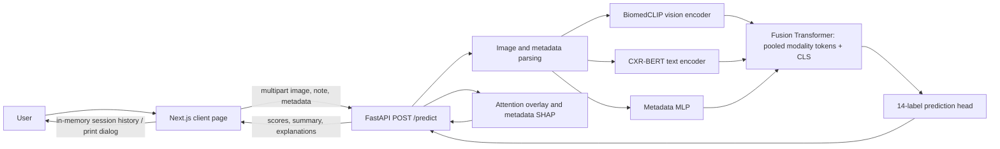
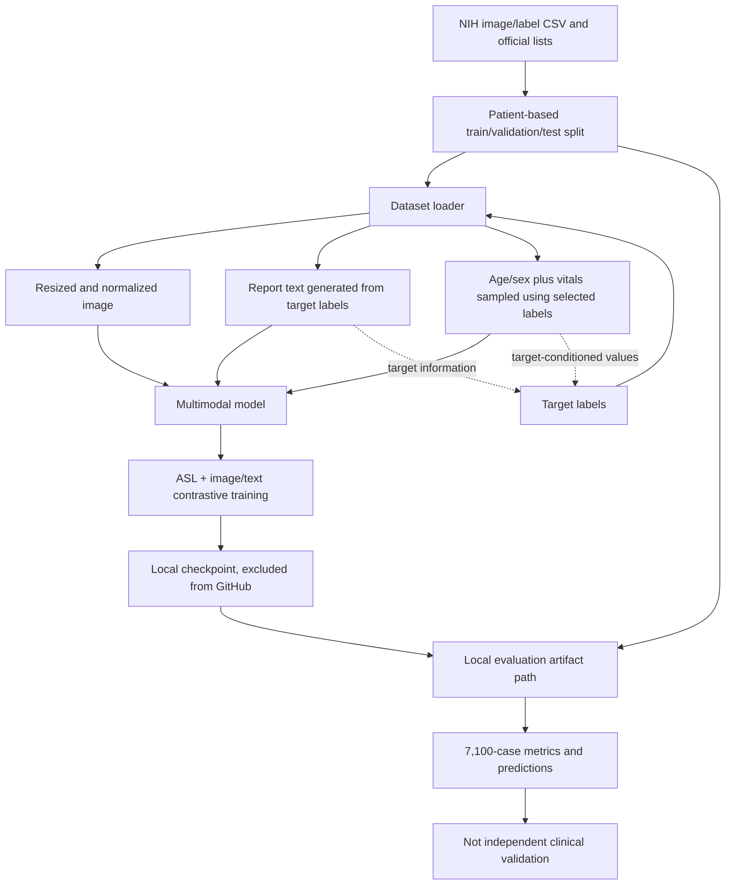

# X-Fusion Project: Complete Context and Evidence Audit

> Historical v1 snapshot, preserved for context. The v2 source changes, executed checks and remaining blockers are recorded in [audit/FINAL_COMPLETION_REPORT.md](../audit/FINAL_COMPLETION_REPORT.md). Legacy startup/model details below are superseded by [HOW_TO_START.md](../HOW_TO_START.md).

**Prepared:** Current workspace audit  
**Purpose:** Source-grounded handoff describing the inspected X-Fusion repository, its local artifacts, and the limits of claims that can be substantiated from them.

> **Important:** X-Fusion is an experimental research prototype, not a clinically validated diagnostic system. In particular, its local evaluation inputs include note and vital-sign features generated from the target labels. The saved near-perfect classification metrics therefore do not establish clinical performance, generalization, or benefit from real multimodal context.

## 1. Executive summary

X-Fusion is a web application for multi-label chest-radiograph screening. A Next.js frontend submits a chest X-ray, an optional clinical note, and structured metadata to a FastAPI backend. The backend loads a PyTorch Lightning model that combines pooled image, text, and metadata representations and returns probabilities for 14 NIH ChestX-ray14 findings.

The main model and application path are present in source. The training/evaluation record is less reproducible: the full image collection, a large model checkpoint, and local result files are deliberately absent from the GitHub snapshot. Local audit artifacts report very high performance on 7,100 cases, but the dataset code constructs clinical notes from the target labels and samples several vitals conditional on selected labels. This is target leakage. The scores must not be described as an unbiased test of diagnostic ability.

Several descriptions in paper drafts and project notes exceed what the executable source supports. The model fuses three pooled modality tokens with a learned classification token using a Transformer encoder; this is not a spatial cross-attention architecture over image patches and text tokens. The image overlay is an attention-derived visualization, not Grad-CAM or validated lesion localization. No evidence was found for segmentation, LoRA, dynamic modality masking, real MIMIC-CXR integration, calibrated probabilities, or clinical validation.

The app has a small API surface and no account system or persistent case database. The browser keeps session history in React state, and its “Export Report” action opens the browser print dialog. A checkpoint is required at backend startup; a clean clone without a separately supplied checkpoint cannot serve predictions.

## 2. Project identity and intended use

The repository calls the project **X-Fusion**. Its stated task is multi-label chest-radiograph classification, with 14 finding labels and optional note/metadata context. It is presented as a research prototype with a browser interface and an HTTP inference service.

The term “screening” in project materials describes intended workflow, not proven clinical utility. The inspected code and artifacts do not establish a medical-device intended-use statement, prospective evaluation, clinician adjudication, clinical workflow integration, regulatory status, or patient-outcome benefit. Do not use outputs to make care decisions.

The audit distinguishes:

* **Source behavior:** behavior visible in executable Python/TypeScript/JavaScript and manifests.
* **Saved artifact evidence:** values and metadata recorded in local files; these establish what the artifacts say, not that the underlying experiment was valid.
* **Documentation or paper claims:** statements in README/setup/review/paper materials, treated as claims until matched to code or reproducible results.
* **Audit inference:** a reasoned conclusion based on those sources, explicitly identified as such.

## 3. Audit scope, method, and constraints

The review covered backend model, data, training, API, and evaluation code; frontend source and dependency manifests; project setup and review documentation; available local metrics, predictions, training records, and checkpoint/evidence metadata; and the LaTeX paper variants relevant to project claims. Separate read-only backend/ML and frontend/research reviews were also completed.

This was a static repository and artifact review. No training, dependency installation, upload, external service call, clinical validation, or full test suite was performed for this document. The task did not authorize source-code edits. The only deliverable created for this audit is this Markdown file.

The working tree already contained unrelated LaTeX/PDF changes and generated files when checked. Those files were left untouched. Their presence is not attributed to this audit.

## 4. Repository layout

The main areas are:

| Area | Role |
|---|---|
| `backend/` | FastAPI service, model, dataset, training scripts, pipeline utilities, and Python dependency declarations. |
| `frontend/` | Next.js App Router application, UI, browser-side request flow, and npm manifests. |
| `documents/latex/` | Multiple conference-paper and architecture-paper variants. |
| `RESEARCH_PAPER/` | Adapted IEEE paper and reference material. |
| `outputs/` | Local predictions and evaluation summaries; not part of the curated GitHub snapshot. |
| `output/` | Local paper-generation, evidence, and training artifacts; not part of the curated GitHub snapshot. |
| Root documentation | Setup notes, project review material, ignore rules, and paper sources. |

The root `.gitignore` is intended to keep large datasets, checkpoints, virtual environments, generated output, and frontend build/dependency folders out of version control. That makes the published code much smaller, but also means a clone alone does not contain everything needed to reproduce the reported experiment or start inference.

## 5. Technology stack and dependencies

**Backend:** Python, FastAPI, Uvicorn, PyTorch, PyTorch Lightning, TorchMetrics, Hugging Face Transformers, OpenCLIP/BiomedCLIP, OpenCV/Pillow, NumPy/pandas/scikit-learn, and SHAP-related code. Exact runtime behavior can depend on the installed versions and on external model-weight availability.

**Frontend:** Next.js App Router, React, TypeScript, Axios, Tailwind CSS, and UI/icon dependencies declared in `frontend/package.json` and its lockfile. The source uses client-side React state for the main experience.

Python dependency declarations use version ranges rather than a complete environment lock. The frontend has npm lock data. The inspected repository does not provide a tested, end-to-end environment lock tying together Python, CUDA, model weights, dataset revision, and frontend/backend builds.

## 6. High-level architecture

The browser is the user-facing client. It builds a multipart request and calls the backend URL configured by `NEXT_PUBLIC_API_URL`, defaulting to `http://localhost:8000`. FastAPI validates basic request fields, decodes the image, parses metadata, runs the loaded model, and returns predictions plus visual/metadata explanation outputs.

The model has three inputs:

1. an X-ray image encoded by a BiomedCLIP/OpenCLIP vision encoder;
2. a clinical text string encoded by a CXR-BERT-compatible text model; and
3. six structured metadata features encoded by a small MLP.

Those pooled vectors are projected to a common width and supplied as modality tokens alongside a learned classification token to a Transformer encoder. A linear output head produces 14 logits. The design is multimodal, but the inspected implementation is a short sequence of pooled vectors, not joint spatial tokenization of all image patches, text tokens, and metadata.

## 7. End-to-end request lifecycle

The user selects or loads a case, reviews the image and metadata, and submits. The frontend posts `image`, `clinical_note`, and serialized `metadata` fields. The API checks that the model is loaded, checks the provided image media type and size, parses metadata JSON, writes the upload to a temporary file for model processing, and attempts to remove that file in cleanup logic.

The model applies image preprocessing, obtains the image/text/metadata embeddings, fuses them, and produces sigmoid probabilities. The API formats the prediction mapping and diagnostic summary and calls the explanation methods. The frontend stores the returned result in page state and renders a result view. The current source does not persist cases in a server database.

Errors surfaced by the API include a not-ready response when no model is loaded, unsupported media type, empty or oversized image, and invalid/non-object metadata JSON. Decoder failures or unexpected model/explanation errors may still produce server errors; the static review did not exercise each error path at runtime.

## 8. User-facing capabilities

The visible workflow includes loading a preset case, uploading an image, editing a note and structured fields, requesting an analysis, displaying the 14-class probability output, viewing a ranked finding summary, displaying an image overlay, viewing metadata attributions, and browsing cases processed during the current page session.

No account creation, role-based workflow, server-side patient record, audit trail, review/approval queue, clinician annotation, or shared multi-user case history was found in the inspected implementation. The demo should therefore be treated as a local prototype.

## 9. Frontend workflow and state

The main interaction is implemented in `frontend/src/app/page.tsx`. The page uses local component state for the selected image, input values, current prediction, view state, and case history. It uses Axios to call `/predict` and reads the API base URL from `NEXT_PUBLIC_API_URL`.

The case history is an in-memory array. A reload or navigation that remounts the page loses it. “Export Report” calls `window.print()`; it is browser printing, not a generated or persisted PDF export. The UI has probability thresholds for display/summary behavior; those are presentation choices, not calibrated clinical decision cutoffs.

The root layout and styles are in `frontend/src/app/layout.tsx` and `frontend/src/app/globals.css`. The inspected app is centered on a single page rather than a multi-route clinical workflow. Preset cases and user-uploaded images should be regarded as demo inputs, not a validated dataset browser.

## 10. Frontend build and run characteristics

Frontend package scripts and dependencies are declared in `frontend/package.json`; the project uses Next.js rather than Vite. The frontend expects a separately running backend unless its API URL is overridden. CORS configuration on the backend is therefore relevant to local cross-origin development.

The source contains no evidence that frontend “Export Report” writes a durable PDF. The browser print path may allow the user to print or save through browser capabilities, but the application itself does not create a PDF document through a PDF-generation library.

## 11. HTTP API contract

The API is defined in `backend/main.py`:

| Method and path | Purpose | Notes |
|---|---|---|
| `GET /health` | Report API/model readiness and device information. | Not a clinical health check or model-quality check. |
| `POST /predict` | Run one image prediction with optional note and metadata. | Multipart upload; requires an image and an initialized model. |

The prediction endpoint accepts an uploaded image, an optional clinical note, and metadata supplied as JSON text. The response includes a mapping of finding names to scores and additional summary/explanation fields, including an overlay and metadata attribution data where available. The response is not defined by a separate OpenAPI schema beyond FastAPI’s endpoint annotations and runtime response construction.

Basic input limits and checks exist, including accepted image media types and a 15 MB size limit. MIME type is not a guarantee that the uploaded bytes are a safe or valid image. The review did not find comprehensive image decompression/resource limits, authentication, authorization, rate limiting, or request-level audit logging.

## 12. Configuration and environment

The frontend API base URL can be set through `NEXT_PUBLIC_API_URL`; absent that setting it targets localhost. Backend CORS origins are configurable in source and have a localhost-oriented default. The API requires model weights from the expected checkpoint location and refuses to intentionally serve random weights if none are available.

Dataset paths, training parameters, and pretrained model access are handled by Python source and scripts. Some pipeline utilities default to `config.yaml`; the expected config is not present in the inspected project snapshot, so those paths are not turnkey without supplying configuration.

No secret values are reproduced in this report. Configuration values should be provided through a local environment or secret manager and not committed. No deployed environment configuration was verified.

## 13. Startup, deployment, and operational dependencies

Backend startup loads model configuration and checkpoint state. Without a compatible checkpoint, inference startup does not become ready. The checkpoint is large and excluded from the GitHub snapshot. Users must separately obtain compatible weights and ensure the code’s expected model dependencies and external pretrained weights are available.

The repository includes developer setup guidance, but the reviewed project does not demonstrate a complete, reproducible deployment bundle with data acquisition, checkpoint provisioning, service orchestration, health monitoring, and tested rollback. No validated Docker/Kubernetes production deployment was established by this audit.

## 14. Prediction task and label space

The task is multi-label classification over 14 NIH ChestX-ray14 findings. Multiple output probabilities may be high for one image; the system is not a mutually exclusive 14-class classifier. The dataset source defines the disease label list and the model head returns 14 logits.

The task target and clinical-note generation are coupled in the dataset loader. This is central to interpreting every reported score: test-patient separation cannot repair label leakage introduced by features constructed directly from the target.

## 15. Dataset provenance and coverage

`backend/data/dataset.py` documents the source dataset as NIH ChestX-ray14, with 112,120 image records and 14 disease labels. The workspace’s local inventory was smaller: 31,877 PNG files were found, and 31,630 CSV/image records matched the local image files. Of the matched records, 24,530 belonged to the official train/validation pool and 7,100 to the official test list.

These are workspace-specific coverage counts, not a claim that the full NIH dataset was present or uploaded. The images, large checkpoint, and local evaluation artifacts are not included in the curated GitHub snapshot. The source dataset’s license, image redistribution rights, and authorization for any real-world use must be checked independently before sharing or deploying data.

## 16. Dataset splits and patient separation

The dataset module uses official `train_val_list.txt` and `test_list.txt` lists and further partitions the train/validation pool by patient ID with a fixed NumPy seed and configurable validation fraction. The local evidence records final counts of 21,964 training, 2,566 validation, and 7,100 test image records.

The audit’s local manifest comparison found no patient-ID overlap among those derived splits. This is evidence of patient separation in the inspected local manifest, not proof that all image duplicates, near-duplicates, metadata joins, or external data are leak-free. More importantly, it does not address synthetic feature leakage described below.

## 17. Clinical-note and vital-sign generation: target leakage

This is the most consequential methodological finding.

The dataset module’s clinical-report generator receives the disease labels and chooses report templates and statements from those labels. The generated note therefore encodes target findings by construction. The metadata generator uses real age/sex fields but samples temperature, heart rate, respiratory rate, and oxygen saturation from distributions conditioned on selected disease labels (including pneumonia/edema conditions). Those generated measurements also carry target-derived information.

The model is thus evaluated with inputs that reveal the labels it is asked to predict. The saved evaluation scores cannot establish performance on independently authored clinical notes or genuine patient vitals. Patient-disjoint splitting does not remove this leakage. A valid multimodal experiment must use notes and measurements that are independent of the target annotation process and collected for the same subjects under a documented protocol.

## 18. Image and input preprocessing

The source resizes radiographs to 224 × 224 and normalizes image tensors for the pretrained vision model. The data module has separate train/validation/test transform paths, but the reviewed implementation does not establish the clinically motivated image pipeline claims found in some paper drafts (for example, CLAHE or lung segmentation).

Metadata includes six numeric inputs corresponding to age, sex encoding, and four vital-sign fields. The implementation applies its metadata MLP, but the review did not find a complete documented scaler fitted only on training data. Raw or synthetic numeric values can therefore be sensitive to units, distributions, missing-value defaults, and outliers.

## 19. Model architecture: encoders and dimensions

The model source defines a vision encoder, text encoder, metadata MLP, fusion module, and 14-output head:

* **Vision:** BiomedCLIP/OpenCLIP image encoding produces a pooled feature documented/configured at width 512.
* **Text:** CXR-BERT produces a CLS representation (typically width 768 in the configured model family) that is projected to width 512.
* **Metadata:** a six-value input is mapped through an MLP (6 → 128 → 512).
* **Fusion:** three width-512 modality tokens plus a learned CLS token are passed through a two-layer, eight-head, width-512 Transformer encoder.
* **Output:** a linear head maps the fused CLS representation to 14 logits.

The exact pretrained checkpoint contents and runtime model configuration are external to the source snapshot; dimensions above reflect the inspected code/configuration and named model family, not an independent reconstruction of every checkpoint tensor.

## 20. Fusion semantics and architecture-claim correction

The implementation forms one pooled representation per modality and applies Transformer self-attention over a sequence of four tokens. This permits interactions among image, text, metadata, and CLS embeddings. It is not patch-level visual-text cross-attention: image patches are not concatenated with text tokens in the fusion sequence, and there is no separate cross-attention layer that queries one modality from another.

Accordingly, “tri-modal fusion” is a reasonable high-level description, while “cross-attention Vision Transformer” overstates the specific fusion mechanism. The visual backbone itself has attention over image patches, but that is distinct from cross-modal attention.

## 21. Training objectives and metrics in code

`backend/models/multimodal_lit.py` implements Asymmetric Loss for multi-label classification and an InfoNCE-style image/text contrastive objective with a temperature parameter. The training module logs task metrics and configures AdamW with a cosine-annealing schedule. Metric thresholds in code are not equivalent to a clinically selected operating point.

The classification objective can train a multi-label head; the contrastive objective aligns the image/text embeddings used by the training batch. It does not, by itself, prove that the note data are genuine or that the learned correlations are clinically meaningful. Given the target-derived notes and vitals, optimization may exploit leakage.

## 22. Training scripts and checkpoint evidence

The repository includes several training entry points, including `backend/train.py`, `backend/train_advanced_laptop.py`, `backend/train_cluster.py`, and pipeline scripts. Their options and environment assumptions are not fully unified. Pipeline scripts that default to `config.yaml` are not directly reproducible from the inspected snapshot without that configuration.

Local `output/xfusion_ieee_final/work/training_records.csv` contains 14 epochs. The recorded training objective decreases from approximately 0.15449 to 0.11904; the final recorded validation ASL is approximately 0.000726. These are optimization traces, not independent evidence of diagnostic utility.

Local checkpoint/evidence metadata records epoch 14, global step 10,305, learning rate `2e-4`, weight decay `1e-4`, text frozen, and a vision-unfreeze configuration. The unfreeze scripts search parameter names matching `transformer.resblocks.10`/`.11`, whereas the recorded checkpoint visual parameter names use a `trunk.blocks.*` form; the evidence records zero matches for the intended name rule. The actual number of vision parameters updated during training is therefore not substantiated by the saved metadata. A fresh training run with explicit parameter counts and optimizer-group logging is needed to resolve this.

The full checkpoint is approximately 1.214 GB and is excluded from GitHub. Its presence locally does not make the public repository self-contained or establish that the checkpoint is reproducible from the committed code.

## 23. Evaluation artifacts and provenance

Local evaluation files include `outputs/xfusion/eval_metrics.json`, `outputs/xfusion/eval_metrics_report.txt`, and `outputs/xfusion/test_predictions.csv`. They record results for 7,100 cases. The report explicitly notes that some multimodal inputs are generated from labels.

The exact program/configuration that produced these result files was not identified in the audited executable backend source. The available pipeline evaluation script is not sufficient provenance for these particular files, including because pipeline defaults expect an absent configuration. The predictions and metric JSON are local artifacts, not a reproducible evaluation package containing dataset revision, exact checkpoint hash, evaluator command, environment lock, and split manifest.

## 24. Quantitative results recorded locally

The local metric JSON/report records the following aggregate values:

| Metric | Recorded value | Scope |
|---|---:|---|
| Macro AUROC | 1.0000 | 14-label, 7,100-case local test artifact |
| Micro AUROC | 1.0000 | Same artifact |
| Macro AUPRC | 0.9953 | Same artifact |
| Macro F1 | 0.9709 | Same artifact |
| Micro F1 | 0.9948 | Same artifact |

The saved prediction table, when recomputed from its rounded values during the audit, yields values slightly below exact 1.0 for AUROC (approximately 0.99996 macro and 0.99999 micro). This small difference is compatible with rounding in the saved JSON/report. These numbers describe the available files only; the leakage warning in Sections 17 and 25 governs their interpretation.

The files do not establish confidence intervals, a prospective cohort result, reader study, statistically valid comparison against a baseline, calibration quality, clinically chosen sensitivity/specificity operating points, subgroup fairness, or patient-level benefit.

## 25. Validity and interpretation of reported metrics

The reported values are not valid evidence of clinical performance because note text and several vitals are generated using target labels. This creates a direct information path from target to input. A very high AUROC in that setting is expected to be inflated and must not be presented as independent diagnostic validation.

The metrics may be reported only with the dataset-generation and leakage caveat prominent, framed as a software/artifact reproduction result rather than a clinical result. Any abstract, presentation, README, or paper that presents them as real-world diagnostic accuracy should be revised or withdrawn until a leakage-free evaluation is run.

The 14-epoch loss history is likewise not a substitute for test metrics. Optimization convergence, patient disjointness, and a saved “test” label do not establish absence of feature leakage or external validity.

## 26. Explainability implementation and limits

The image explanation code hooks the final visual attention block, calculates/averages CLS-to-patch attention across heads, reshapes patch scores to a grid, resizes it, colors it, and overlays it on the input. This is an attention visualization. It is not Grad-CAM, does not establish causal feature importance, and has not been validated for lesion localization or clinical interpretability.

The metadata SHAP path holds the image and text representations fixed while varying structured metadata, uses a zero-style background, and aggregates absolute effects across the 14 outputs before normalization. Its result is conditional on that background, model, input encoding, and aggregation choice; it should not be presented as a clinically validated explanation.

The service catches SHAP failures and can return an empty attribution object. The UI/API should distinguish “explanation unavailable” from “no metadata contribution.” Explanation output does not repair the label leakage or validate predictions.

## 27. Security, privacy, and safety posture

The inspected API has no authentication or authorization. CORS restricts browser origins by configuration but is not an access-control mechanism. The service accepts medical-image-like uploads, so deployment requires explicit access control, transport security, rate limits, request-size and decoder-resource controls, audit and retention policy, privacy review, and secure checkpoint handling.

The endpoint has a 15 MB input-size limit and temporary-file cleanup logic. Static review cannot establish behavior under malformed image files, decompression bombs, concurrent load, process termination during upload, or disk exhaustion. No security penetration test or dependency vulnerability assessment was performed for this document.

Avoid uploading real patient images or identifiable clinical notes to a public or shared instance. Apply the dataset and institutional terms that govern the underlying data. Do not treat the prototype as a medical device or use its predictions for diagnosis or treatment.

## 28. Tests and validation coverage

The repository contains a manual/all-cases smoke script (`test_allcases.py`) that sends example requests and prints results. It is not evidence of a comprehensive automated test suite: no broad assertion-based coverage of API validation, model correctness, frontend flows, split integrity, leakage controls, or explanation semantics was established in this audit.

No build, unit test, integration test, browser flow, model training, or API execution was run for this documentation task. The prior paper-specific LaTeX compilation belongs to earlier work and does not validate this application. Add repeatable tests for the model contract, patient split disjointness, data provenance, API error behavior, and a leakage-free evaluation before making performance claims.

## 29. Documentation and source-claim reconciliation

`HOW_TO_START.md` is useful for basic setup but should be checked against current model/checkpoint requirements and missing configuration files. `PROJECT_REVIEW_GUIDE.md` is comparatively cautious about evidence and limitations. `project_review_parameters.md` and older paper drafts include claims that do not align with the inspected implementation, including alternative frontend technology descriptions, PDF export, segmentation, and stronger benchmark claims.

The source is authoritative for current behavior. A paper title, figure, planned feature, generated artifact, or commented TODO does not prove that a feature is implemented or validated. In particular, distinguish:

* a feature represented by executable code;
* an experiment recorded in a local CSV/JSON;
* an approach stated in a draft or review checklist; and
* a validated outcome on independent data.

## 30. Research-paper context

The repository has several LaTeX paper variants, including the adapted IEEE draft under `RESEARCH_PAPER/` and additional files under `documents/latex/`. They should not be assumed to be interchangeable or mutually consistent. Earlier work in this conversation fixed an IEEE author-block compile issue and produced a paper draft in the research-paper folder; that work is separate from this source/experiment audit.

Before submission, reconcile the paper’s model name and fusion description with Sections 19–20; remove or qualify any metric claim affected by target leakage; identify the exact dataset subset and split; cite the exact code/checkpoint/evaluator revision; distinguish generated notes/vitals from real clinical modalities; and state that attention overlays are not validated lesion localization. Verify all references and every reported number against the local artifact and a reproducible command. Do not copy unverified claims between draft variants.

## 31. Known limitations and failure modes

1. No model checkpoint is included in the curated repository; API startup depends on separate weights.
2. The local multimodal evaluation has target-derived note/vital inputs.
3. The exact producer of the local evaluation artifacts is not established.
4. Some training pipeline paths require a `config.yaml` absent from the inspected snapshot.
5. The reported vision-layer unfreeze behavior is not substantiated by matching parameter names.
6. Probability thresholds in the UI are not shown to be calibrated or clinically selected.
7. Explanations are attention/SHAP approximations with material methodological limits.
8. Browser case history is transient and there is no backend persistence.
9. No authentication, authorization, or production privacy controls were established.
10. Several documents and paper drafts contain inconsistent or unsupported claims.

## 32. Risk register and recommended remediation

| Priority | Risk | Evidence | Recommended action |
|---|---|---|---|
| Critical | Target leakage invalidates multimodal performance interpretation. | Label-derived notes and label-conditioned synthetic vitals in dataset source. | Rebuild the experiment with independently sourced inputs; keep clinical notes/vitals out until provenance is verified. Recompute every split and metric. |
| Critical | Paper or product claims may overstate clinical validity. | Saved near-perfect scores plus inconsistent draft claims. | Withdraw/qualify such claims; state the leakage limitation prominently; do not use clinically. |
| High | Results are not fully reproducible from the published repository. | Checkpoint/data/results omitted; evaluator/config provenance incomplete. | Publish a lawful data manifest, checkpoint hash/source, config, exact command, environment lock, and evaluator version; do not publish restricted data. |
| High | Intended partial vision fine-tuning may not have occurred. | Script name patterns do not match recorded checkpoint parameter naming; zero matched names recorded. | Log matched/frozen/trainable parameter names and counts; assert expected counts; rerun and preserve logs. |
| High | Unauthenticated endpoint handles sensitive image/note data. | No auth/authz observed; upload API. | Add deployment-grade identity/access controls, TLS, resource limits, retention controls, monitoring, and a privacy threat model. |
| Medium | Misleading explanations and thresholds. | Attention overlay and aggregated Kernel SHAP; fixed UI cutoffs. | Label explanations as exploratory; validate localization/attribution separately; calibrate thresholds on independent clinical data. |
| Medium | Operational setup is fragile for a clean clone. | External checkpoint/pretrained weights and missing default pipeline config. | Document tested setup from clean clone, provision model assets securely, add config example and startup checks. |
| Medium | Manuscript variants diverge from source. | Multiple paper files and unsupported implementation claims. | Select one canonical draft and run a claim-to-source/evidence review before submission. |

## 33. Mermaid diagrams

### 33.1 Runtime component and data flow

### 33.2 Training and evaluation evidence path

## 34. Source-to-claim evidence, file inventory, coverage, and unresolved verification

### 34.1 Source-to-claim evidence matrix

| Claim in this document | Primary evidence |
|---|---|
| API endpoints and upload handling | [`backend/main.py`](../backend/main.py): startup/model loading, `/health`, `/predict`, validation and response construction. |
| Model encoders and fusion | [`backend/models/multimodal.py`](../backend/models/multimodal.py): `MultimodalModel`, image/text encoders, metadata encoder, token construction and Transformer. |
| 14-label objective and optimizer | [`backend/models/multimodal_lit.py`](../backend/models/multimodal_lit.py): Asymmetric Loss, contrastive objective, metrics, AdamW and scheduler. |
| 14 labels and local dataset behavior | [`backend/data/dataset.py`](../backend/data/dataset.py): label list, report generation, metadata generation, image transforms and DataModule split. |
| Synthetic notes encode the target | [`backend/data/dataset.py`](../backend/data/dataset.py): report generation accepts the disease list and selects label-specific templates. |
| Synthetic vitals are label-conditioned | [`backend/data/dataset.py`](../backend/data/dataset.py): metadata generator samples vital distributions based on selected findings. |
| Image overlay is attention-based | [`backend/models/multimodal.py`](../backend/models/multimodal.py): final-block QKV/attention hook, patch-grid reshape and overlay. |
| SHAP method and limitations | [`backend/models/multimodal.py`](../backend/models/multimodal.py): metadata prediction wrapper and KernelExplainer path. |
| Training variants and unfreeze naming | [`backend/train.py`](../backend/train.py), [`backend/train_advanced_laptop.py`](../backend/train_advanced_laptop.py), and [`backend/train_cluster.py`](../backend/train_cluster.py). |
| Pipeline configuration assumptions | [`backend/pipelines/train.py`](../backend/pipelines/train.py), [`backend/pipelines/eval.py`](../backend/pipelines/eval.py), and [`backend/pipelines/evaluate_roc.py`](../backend/pipelines/evaluate_roc.py). |
| Browser request and API URL | [`frontend/src/app/page.tsx`](../frontend/src/app/page.tsx): `API_URL`, request construction, and POST call. |
| In-memory history and print action | [`frontend/src/app/page.tsx`](../frontend/src/app/page.tsx): `caseHistory` state and `window.print()`. |
| Frontend stack and scripts | [`frontend/package.json`](../frontend/package.json). |
| Local aggregate metrics and prediction evidence | `outputs/xfusion/eval_metrics.json`, `outputs/xfusion/eval_metrics_report.txt`, and `outputs/xfusion/test_predictions.csv` (local artifacts, excluded from the curated GitHub snapshot). |
| Local split/checkpoint metadata | `output/xfusion_ieee_final/work/evidence.json` (local evidence artifact; verify against raw manifests/checkpoint before reuse). |
| Local training trace | `output/xfusion_ieee_final/work/training_records.csv` (14-epoch record; not a clinical-performance result). |
| Setup and project-level statements | [`HOW_TO_START.md`](../HOW_TO_START.md), [`PROJECT_REVIEW_GUIDE.md`](PROJECT_REVIEW_GUIDE.md), and [`project_review_parameters.md`](project_review_parameters.md). |
| Manuscript variants | [`X_Fusion_IEEE_Paper.tex`](X_Fusion_IEEE_Paper.tex), [`RESEARCH_PAPER/`](../RESEARCH_PAPER), and [`documents/latex/`](documents/latex/). |
| Large/local artifact exclusions | [`.gitignore`](../.gitignore). |

### 34.2 Inspected file inventory by area

The audit inventory covered the repository’s backend Python sources and pipeline scripts; frontend TypeScript/TSX, styles, layout, and npm manifests; root setup/review documentation; paper sources and reference materials; and the available local evidence, predictions, metrics, and training records. Principal reviewed paths are:

* Backend/API/model: `backend/main.py`, `backend/models/multimodal.py`, `backend/models/multimodal_lit.py`.
* Backend/data: `backend/data/dataset.py` and the data preparation/setup sources present in the repository.
* Backend/training/evaluation: `backend/train.py`, `backend/train_advanced_laptop.py`, `backend/train_cluster.py`, `backend/pipelines/train.py`, `backend/pipelines/eval.py`, `backend/pipelines/evaluate_roc.py`.
* Frontend: `frontend/src/app/page.tsx`, `frontend/src/app/layout.tsx`, `frontend/src/app/globals.css`, `frontend/package.json`, and the npm lockfile.
* Project guidance: `HOW_TO_START.md`, `PROJECT_REVIEW_GUIDE.md`, `project_review_parameters.md`, and `.gitignore`.
* Research materials: root IEEE source, `RESEARCH_PAPER/X_Fusion_IEEE_Final.tex`, and the LaTeX sources under `documents/latex/`.
* Local experimental evidence: `outputs/xfusion/` metric/prediction files and `output/xfusion_ieee_final/work/` evidence/training files, which are not part of the public Git snapshot.

The 93-file project inventory was enumerated during the audit. This number describes files inventoried, not a claim that every generated binary, dependency cache, dataset image, or checkpoint tensor was individually inspected. Core executable sources and relevant text/JSON/CSV evidence were reviewed directly or through the read-only specialist reviews.

### 34.3 Coverage summary

| Topic | Coverage |
|---|---|
| Backend endpoints, startup, checkpoint requirements | Source reviewed |
| Model architecture, objectives, explainability | Source reviewed; external weights not reconstructed |
| Dataset labels, local coverage, split logic | Source and local evidence reviewed |
| Multimodal leakage | Source reviewed; identified as a critical validity issue |
| Saved metrics, predictions, training trace | Local artifacts reviewed; producing run not fully reproduced |
| Frontend request, UI state, report action | Source and package manifest reviewed |
| Documentation and paper-claim consistency | Key guidance and paper variants reviewed |
| Production security, clinical validity, legal compliance | Static observations only; no formal assessment performed |
| Build, test, training, runtime load, browser behavior | Not run for this audit |

### 34.4 Unresolved verification items

1. Reproduce the exact local metric files from a pinned evaluator, config, checkpoint hash, environment, and split manifest.
2. Confirm the local image/CSV joins and all patient/image-level duplicates against the original dataset manifests.
3. Re-run evaluation with notes and vitals that are independent of the labels, or evaluate image-only until valid paired modalities are available.
4. Verify whether intended visual layers were trainable by logging actual matched parameter names and optimizer-group counts.
5. Establish the model checkpoint’s precise architecture/configuration and lawful source/provenance.
6. Validate calibration, thresholds, subgroup performance, uncertainty, and external generalization on an independent cohort with appropriate oversight.
7. Test API behavior, image-decoder/resource limits, temporary-file cleanup, concurrency, and browser flows using automated tests.
8. Reconcile manuscript metric and architecture claims and select one canonical paper source.
9. Verify any dataset redistribution, pretrained-weight license, privacy, institutional approval, and intended-use requirements before deployment or publication.

### 34.5 Final assessment

The source supports describing X-Fusion as a prototype multimodal 14-label chest-X-ray application with a FastAPI backend and Next.js frontend. It does **not** support describing the current result artifacts as unbiased clinical performance, the attention map as validated lesion localization, or the overall system as ready for patient care. The target-derived modalities, incomplete artifact provenance, and missing checkpoint in the public snapshot are the primary blockers to stronger claims.
