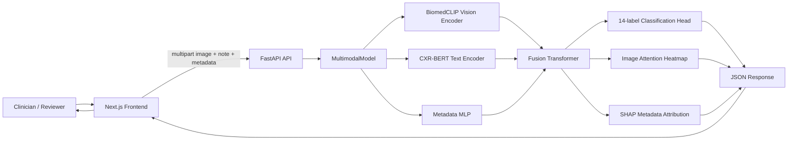

# X-Fusion Project Review Guide

> Historical review material. Current verified status and PPT coverage are in [audit/FINAL_COMPLETION_REPORT.md](../audit/FINAL_COMPLETION_REPORT.md) and [audit/REQUIREMENTS_TRACEABILITY.md](../audit/REQUIREMENTS_TRACEABILITY.md). Historical scores do not establish valid tri-modal performance.

## How to Use This Document

This is a one-hour preparation guide for the X-Fusion project review. Read the **30-second explanation**, **architecture**, **data flow**, **model**, and **viva questions** first. The appendix contains implementation details and limitations.

This guide is based on the code currently present in the repository. Statements marked **implemented** are visible in the source code. Statements marked **intended**, **claimed**, or **future work** should not be presented as experimentally proven unless you have separate results to show.

---

## 1. Project in One Minute

**X-Fusion is a tri-modal AI-assisted chest X-ray screening system.** It accepts three kinds of patient information:

1. A chest X-ray image.
2. A short clinical note.
3. Six structured values: age, sex, temperature, heart rate, respiratory rate, and oxygen saturation.

The system processes each input with a suitable encoder:

- **BiomedCLIP** extracts medical visual features from the X-ray.
- **CXR-BERT** extracts medical language features from the clinical note.
- A small **MLP neural network** encodes the six vital/metadata values.

These three feature vectors are projected to the same size and combined by a two-layer Transformer fusion module. A 14-output classification head produces one probability for each ChestX-ray14 disease category. The backend also produces an attention-based image heatmap and SHAP-based metadata attributions for explainability.

The user interacts with the system through a Next.js clinical workstation. The frontend sends a multipart request to a FastAPI backend. The backend loads a trained checkpoint, performs inference, and returns JSON results. The frontend then displays the diagnosis, disease probabilities, heatmap, metadata explanation, and temporary case history.

### Short presentation script

> "Our project is X-Fusion, a multimodal chest X-ray screening prototype. Instead of depending only on the image, it combines image information, clinical text, and patient metadata. BiomedCLIP handles the image, CXR-BERT handles the clinical note, and an MLP handles six structured values. A Transformer fuses these modalities, and a multi-label head predicts fourteen possible findings. FastAPI serves the model and Next.js provides the clinical user interface. We also include explainability through a visual attention heatmap and metadata attributions. The current system is a research prototype, so it should support a clinician rather than replace clinical diagnosis."

---

## 2. Problem Being Solved

Chest X-ray interpretation can be difficult because the image is only one part of a clinical decision. A radiologist may also use symptoms, vital signs, age, and sex. A model that sees only pixels may miss useful context, while a model that sees only text cannot inspect the radiograph.

X-Fusion addresses this by combining complementary information sources:

- **Image modality:** What is visible in the chest radiograph?
- **Text modality:** What symptoms and observations are described?
- **Metadata modality:** What is the patient's basic clinical state?

The project focuses on automated screening for findings such as pneumonia, effusion, edema, consolidation, cardiomegaly, pneumothorax, and other categories from the NIH ChestX-ray14 label set.

The output is not a final medical diagnosis. It is a ranked set of model probabilities intended to help prioritize or review a case.

---

## 3. Main Objectives

### Functional objectives

- Upload a chest X-ray through a web interface.
- Enter or select a clinical note.
- Enter six patient metadata/vital values.
- Obtain probabilities for 14 findings.
- Show a primary finding and a screening flag.
- Generate a heatmap over the image.
- Show metadata feature attributions.
- Keep a temporary history of analyses during the browser session.

### Technical objectives

- Use pretrained medical foundation models instead of training image and text encoders from zero.
- Reduce feature dimensions to a common 512-dimensional representation.
- Fuse modalities using attention rather than simply concatenating raw values.
- Support multi-label prediction because one X-ray can contain multiple findings.
- Keep the backend and frontend separate so either can be replaced independently.

### Research objectives

- Explore whether image, text, and metadata provide complementary information.
- Demonstrate an explainable medical-AI workflow.
- Provide a platform that can later be evaluated with stronger clinical data and external validation.

---

## 4. High-Level Architecture



### Repository map

| Area | Important files | Responsibility |
|---|---|---|
| Backend API | `backend/main.py` | FastAPI app, startup loading, `/health`, `/predict` |
| Main model | `backend/models/multimodal.py` | Vision, text, metadata encoders, fusion, inference, explanations |
| Training wrapper | `backend/models/multimodal_lit.py` | PyTorch Lightning training and validation logic |
| Dataset | `backend/data/dataset.py` | NIH CSV parsing, image loading, labels, notes, metadata, splits |
| Training entry points | `backend/train.py`, `backend/train_advanced_laptop.py`, `backend/train_cluster.py` | Laptop and cluster training configurations |
| Reusable pipelines | `backend/pipelines/train.py`, `backend/pipelines/eval.py` | Config-driven train/evaluate path |
| Dataset scripts | `backend/scripts/` | Download and prepare dataset utilities |
| Frontend | `frontend/src/app/page.tsx` | Complete client-side workstation and result views |
| Frontend styling | `frontend/src/app/globals.css`, `frontend/src/app/layout.tsx` | Global styles and app layout |
| Checkpoint | `backend/checkpoints/*.ckpt` | Saved trained weights |
| Test smoke script | `test_all_cases.py` | Sends four sample cases to a running backend |
| Paper | `documents/latex/IEEE_X_Fusion_Paper.tex` | LaTeX paper draft |
| Setup | `HOW_TO_START.md`, `requirements.txt` | Installation and run instructions |

---

## 5. End-to-End Request Flow

### A. User input

The user opens the Next.js application and chooses one of the following:

- Upload or drag-and-drop an image.
- Load one of four preset sample cases.
- Type a clinical note.
- Enter age, sex, temperature, heart rate, respiratory rate, and SpO2.

The frontend stores these values in React state.

### B. Request creation

When the user clicks the analysis action, `page.tsx` creates a `FormData` object with:

- `image`: the selected image file.
- `clinical_note`: text, or a default note if blank.
- `metadata`: a JSON string containing six values.

The frontend sends the request to:

```text
POST http://localhost:8000/predict
```

### C. Backend processing

`backend/main.py` performs these operations:

1. Receives the multipart upload.
2. Writes the image to a temporary file.
3. Parses the metadata JSON.
4. Calls `MultimodalModel.infer()`.
5. Calls `get_xai_heatmap()`.
6. Calls `get_shap_values()`.
7. Adds all outputs to one JSON response.
8. Deletes the temporary image file.

### D. Model processing

The model:

1. Resizes the image to `224 x 224` and normalizes it using ImageNet mean and standard deviation.
2. Encodes the image with BiomedCLIP.
3. Tokenizes the clinical note and encodes it with CXR-BERT.
4. Converts the six metadata values with the MLP.
5. Creates four tokens: a learned `[CLS]` token, vision token, text token, and metadata token.
6. Sends the four tokens through a two-layer Transformer encoder.
7. Uses the fused `[CLS]` representation to produce 14 logits.
8. Applies sigmoid independently to obtain 14 probabilities.

### E. Frontend result

The frontend displays:

- Sorted disease probabilities.
- The top finding.
- A finding/no-finding screening status using a `0.30` threshold for the highest probability.
- The image heatmap.
- Metadata attribution values.
- A generated summary.
- The result in in-memory case history.

---

## 6. Model Architecture in Simple Words

### 6.1 Vision encoder: BiomedCLIP

BiomedCLIP is a medical vision-language model. In this project, its vision side is used to convert a chest X-ray into a learned numeric representation of size 512.

The model is initialized from:

```text
hf-hub:microsoft/BiomedCLIP-PubMedBERT_256-vit_base_patch16_224
```

The input image is resized to `224 x 224`. A ViT-B/16 image has a `14 x 14` patch grid because each patch is `16 x 16` pixels. The executable model uses the pooled image embedding as one vision token for fusion.

### 6.2 Text encoder: CXR-BERT

CXR-BERT is a language model specialized for chest radiology. The clinical note is tokenized up to 256 tokens. The first hidden-state representation is treated as the note representation.

CXR-BERT typically produces a 768-dimensional vector. A linear projection maps it to 512 dimensions so it can interact with the vision and metadata features.

### 6.3 Metadata encoder

The metadata input has six values:

```text
[age, sex, temperature, heart_rate, resp_rate, spo2]
```

The MLP is:

```text
6 -> 128 -> 512
```

It uses GELU activations and dropout. The resulting vector becomes the metadata token.

### 6.4 Fusion Transformer

The fusion module creates a learned 512-dimensional `[CLS]` token and concatenates:

```text
[CLS], [vision], [text], [metadata]
```

This gives a sequence of four tokens. A two-layer, eight-head Transformer encoder allows each modality to attend to the others. The final `[CLS]` output is treated as the joint representation of the case.

This is useful because a finding may be more convincing when multiple modalities agree. For example, an image pattern, a fever in the note, and low oxygen saturation may jointly increase the model's pneumonia probability.

### 6.5 Classification head

The classification head is:

```text
Dropout(0.3) -> Linear(512, 14)
```

There is one output logit for each disease. Sigmoid is used separately for each output, so multiple findings can be positive at the same time.

This is **multi-label classification**, not ordinary multi-class classification.

- Multi-class: exactly one class is selected.
- Multi-label: zero, one, or many findings may be present.

### 6.6 Output labels

The 14 labels are:

1. Atelectasis
2. Cardiomegaly
3. Effusion
4. Infiltration
5. Mass
6. Nodule
7. Pneumonia
8. Pneumothorax
9. Consolidation
10. Edema
11. Emphysema
12. Fibrosis
13. Pleural Thickening
14. Hernia

---

## 7. Training Pipeline

### Dataset source and split

The main data module is designed for NIH ChestX-ray14. It reads:

- `Data_Entry_2017_v2020.csv`
- `train_val_list.txt`
- `test_list.txt`
- PNG images under `images/`

The official train/validation list is split again into train and validation by patient ID. A fixed NumPy seed of 42 is used for this patient-level split. The official test list is kept separate.

This design is important because one patient can have multiple images. A patient-wise split reduces the risk of the same patient's images appearing in both training and validation.

### Per-sample output

Each dataset item returns:

```text
image, clinical_note, metadata_tensor, 14-element_label_tensor
```

Images receive resizing, normalization, and training augmentation. The training set also uses random horizontal flip, rotation, brightness, and contrast changes.

### Loss function

The training wrapper uses Asymmetric Loss for imbalanced multi-label classification. It gives different treatment to positive and negative examples and reduces the influence of easy negative labels.

The training objective also includes a vision-text InfoNCE contrastive loss:

```text
Total loss = Asymmetric classification loss + 0.1 * InfoNCE loss
```

InfoNCE encourages the vision embedding and the matching text embedding in the same batch to be closer than mismatched pairs.

### Optimizer and scheduler

The optimizer is AdamW. A cosine annealing learning-rate scheduler is configured. Heavy pretrained encoders are frozen in the basic training path. The advanced script tries to unfreeze the final vision blocks.

### Available training modes

| Script | Intended use | Main settings |
|---|---|---|
| `backend/train.py` | Laptop-friendly training | Batch size 8, three epochs, vision/text frozen |
| `backend/train_advanced_laptop.py` | More expensive laptop training | Batch size 4, 15 epochs, mixed precision, gradient accumulation |
| `backend/train_cluster.py` | GPU/cluster training | Larger batch and distributed-oriented settings |
| `backend/pipelines/train.py` | Configurable pipeline | Reads YAML configuration |

---

## 8. Inference API

### `GET /health`

Returns a small status object such as:

```json
{"status": "ok", "device": "cpu"}
```

The current backend intentionally forces CPU inference in `load_model()` to avoid GPU memory pressure.

### `POST /predict`

Inputs:

| Field | Type | Meaning |
|---|---|---|
| `image` | uploaded file | Chest X-ray image |
| `clinical_note` | form text | Optional clinical description |
| `metadata` | JSON form text | Age, sex, temperature, heart rate, respiratory rate, SpO2 |

The response contains fields similar to:

```json
{
  "predictions": {
    "Pneumonia": 0.82,
    "Effusion": 0.61
  },
  "diagnosis": "Pneumonia",
  "has_findings": true,
  "primary_finding": "Pneumonia",
  "primary_confidence": 0.82,
  "heatmap": "data:image/jpeg;base64,...",
  "metadata_attributions": {
    "age": 0.12,
    "temperature": 0.28,
    "spo2": 0.31
  }
}
```

The exact values depend on the checkpoint and input.

### Why temporary files are used

The uploaded bytes are written to a temporary image file because the model's inference helper currently accepts an image path. The `finally` block deletes the file after prediction and explanation are complete.

---

## 9. Frontend Architecture

The frontend is a Next.js App Router application. The main page is a client component with React state. It currently behaves like a single-page workstation rather than a set of server-rendered pages.

### Main UI states

- **Dashboard:** session scan count, flagged cases, model input summary, and start action.
- **Upload:** image input, sample cases, note, and metadata form.
- **Analyzing:** processing state while the request is active.
- **Results:** diagnosis, probabilities, heatmap, explanations, and report controls.
- **History:** results stored in the current browser session.

### Frontend libraries

- Next.js and React for the application.
- Axios for API requests.
- Framer Motion for transitions.
- Lucide React for icons.
- Tailwind CSS utilities and `tailwind-merge` for styling.

### Important frontend behavior

The frontend calls the URL in `NEXT_PUBLIC_API_URL`, defaulting to `http://localhost:8000/predict`. Therefore, the backend must be running on port 8000 while the frontend is running on port 3000 unless both settings are changed.

History is only stored in React memory. Refreshing the page removes it. The export action uses browser printing rather than creating a server-side PDF.

---

## 10. Explainability

Explainability is included because medical users need more than a number. They should be able to inspect which image regions and input values influenced the result.

### Image heatmap

The backend attaches a hook to the final vision attention block, extracts query-key attention, takes the class token's attention to image patches, averages attention heads, reshapes the 196 patch values into a `14 x 14` grid, and overlays the resized map on the image.

This provides a visual indication of where the vision encoder is attending.

Important accuracy in wording: the current implementation is an attention-based ViT heatmap. It is not a complete gradient-based Grad-CAM or a full layer-wise Chefer attention rollout because it does not use the target logit gradient or accumulate attention across all layers.

### Metadata SHAP values

The SHAP helper holds image and text features fixed and varies the six metadata values. Kernel SHAP estimates the contribution of each metadata feature, then the code sums absolute contributions over all 14 outputs and normalizes them for display.

This answers:

> Which metadata fields changed the model's overall output magnitude for this case?

It does not directly answer:

> Which metadata field caused the Pneumonia probability to increase or decrease?

The current returned values are unsigned aggregate importance values, so they should be called **relative metadata importance**, not signed clinical influence.

---

## 11. How to Run the Demonstration

### Prerequisites

- Python 3.10 or newer.
- Node.js 18 or newer.
- npm 9 or newer.
- Enough disk space and memory for PyTorch and pretrained model downloads.
- Dataset and model files for training or inference.

### Install backend dependencies

From the project root:

```powershell
python -m venv venv
venv\\Scripts\\Activate.ps1
pip install -r requirements.txt
```

### Install frontend dependencies

```powershell
cd frontend
npm install
cd ..
```

### Start the backend

Use a terminal at the project root:

```powershell
venv\\Scripts\\Activate.ps1
python -m uvicorn backend.main:app --host 0.0.0.0 --port 8000 --reload
```

The server resolves the checkpoint relative to `backend/main.py`, so it can be started from the project root without depending on the current working directory. Set `XFUSION_DEVICE=cpu` to force CPU or leave it as `auto` to use CUDA when available. Set `XFUSION_ALLOWED_ORIGINS` to a comma-separated list of trusted frontend origins for non-local use.

Check:

```powershell
Invoke-RestMethod http://localhost:8000/health
```

Swagger documentation is available at:

```text
http://localhost:8000/docs
```

### Start the frontend

Use a second terminal:

```powershell
cd frontend
npm run dev
```

Open:

```text
http://localhost:3000
```

### Run the four-case smoke test

With the backend running from the project root:

```powershell
python test_all_cases.py
```

This sends the four sample cases in `frontend/public/` and prints the primary diagnosis and top predictions.

### Demonstration order for the review

1. Open the dashboard.
2. Start a new analysis.
3. Select a preset case so the image, note, and metadata are filled together.
4. Submit the analysis.
5. Explain that the backend is processing three modalities.
6. Show the ranked 14-label output.
7. Show the heatmap and metadata attributions.
8. Open case history and explain that it is session-local.
9. Open `/docs` to show the API contract.

---

## 12. What Is Actually Implemented vs Intended

### Implemented in the current code

- FastAPI backend with `/health` and `/predict`.
- Next.js frontend with upload, preset cases, results, theme, and session history.
- BiomedCLIP vision encoder loading.
- CXR-BERT text encoder loading.
- Six-value metadata MLP.
- Two-layer Transformer-based feature fusion.
- Fourteen independent disease outputs.
- Checkpoint loading.
- Attention-derived image overlay.
- Kernel SHAP metadata attribution.
- NIH CSV and official-list based data handling.
- PyTorch Lightning training wrapper.

### Present in documentation or paper but not fully demonstrated by the code

- Four separate external datasets.
- A complete clinical validation study.
- Verified macro-AUROC and mAP values.
- Pointing-game accuracy evaluation.
- DeLong statistical comparison.
- A reproducible ablation study.
- Full gradient-based Chefer attention rollout.
- Runtime benchmarking that proves the displayed latency.
- Production-grade authentication, persistence, monitoring, and deployment.

The safest review language is: **"The current repository implements a multimodal prototype and inference demo. The larger clinical evaluation and external validation are planned research work unless supported by separate experiment artifacts."**

---

## 13. Important Limitations and Risks

These are useful to know before the review because they show technical maturity.

### 13.1 Synthetic text creates target leakage

In `dataset.py`, the clinical note is generated directly from the disease labels. For example, a Pneumonia label produces a pneumonia-related report. The model can therefore use the note to recover the answer instead of learning an independent clinical signal.

### 13.2 Synthetic vitals also depend on labels

Temperature, heart rate, respiratory rate, and SpO2 are sampled using different distributions when Pneumonia or Edema is present. This means the metadata contains information generated from the target.

This is called **target leakage**. It can make validation results look better than real-world performance.

### 13.3 Evaluation is not fully reproducible

The generated reports and synthetic vitals use Python's random module inside `__getitem__()`. The same image can therefore receive different text and vital values on different reads.

### 13.4 Checkpoint and startup safety

The server now refuses to start inference when no checkpoint is found or when the checkpoint is missing model keys. This prevents accidental predictions from random classification weights.

### 13.5 CPU inference is slow

The backend forces the model onto CPU. Heatmap generation and Kernel SHAP add extra work, and SHAP can be especially expensive because it evaluates many metadata perturbations.

### 13.6 Input validation is limited

The API now validates JPEG, PNG, and WebP content types, rejects empty or oversized uploads, validates metadata JSON, and does not advertise DICOM support. It still does not validate radiograph orientation, image dimensions beyond what preprocessing resizes, or clinical authenticity.

### 13.7 CORS is configurable

Local development defaults to `http://localhost:3000`. Production should set `XFUSION_ALLOWED_ORIGINS` to the deployed frontend origin rather than opening access broadly.

### 13.8 Configuration paths are inconsistent

Some scripts expect a root `config.yaml`, while the visible repository structure does not show one. Training scripts also use different learning rates, freezing settings, checkpoint names, and hardware assumptions.

### 13.9 Paper and executable architecture differ

The paper describes patch-token fusion and richer training/evaluation features, while the executable model fuses a pooled image token and does not implement every reported experiment. This should be resolved before treating paper metrics as reproducible.

### 13.10 The system is decision support, not autonomous diagnosis

A model probability is not a medical diagnosis. A safe deployment needs external validation, calibrated thresholds, clinical review, bias analysis, audit logging, privacy controls, and regulatory consideration.

---

## 14. Good Improvements to Propose

Present these as the next development phase:

1. Replace generated reports with real radiology reports or train an image-only baseline first.
2. Replace label-conditioned synthetic vitals with real patient vitals or add a missing-data pathway.
3. Add deterministic seeds and freeze the exact evaluation inputs.
4. Add a strict checkpoint requirement at startup.
5. Add validation for file type, file size, malformed JSON, and image dimensions.
6. Add calibrated per-label thresholds instead of using one top-score threshold for every finding.
7. Save predictions and compute per-class AUROC, AUPRC/mAP, sensitivity, specificity, F1, and calibration.
8. Add unit tests for metadata parsing, label encoding, API schema, and model tensor shapes.
9. Add an integration test that starts the API and submits a known sample.
10. Move the API URL to an environment variable.
11. Restrict CORS and add authentication before deployment.
12. Cache model initialization and optimize or make SHAP optional for faster response time.
13. Use a proper target-specific explainability method and validate heatmaps with clinical annotations.
14. Create a single configuration file shared by training, evaluation, and serving.
15. Maintain a model card describing training data, intended use, limitations, and ethical risks.

---

## 15. Likely Review Questions and Simple Answers

### Q1. Why is this called multimodal or tri-modal?

Because it combines three input types: image, clinical text, and structured metadata.

### Q2. Why use BiomedCLIP?

It is pretrained on biomedical image-text information, so it provides a useful medical visual representation without training a large vision model from zero.

### Q3. Why use CXR-BERT instead of a general language model?

CXR-BERT is specialized for chest radiology language and should represent radiology terms more appropriately than a general-purpose text encoder.

### Q4. Why is the task multi-label?

A chest X-ray can show several findings simultaneously, such as pneumonia and effusion. Each of the 14 labels therefore has an independent sigmoid probability.

### Q5. Why not use softmax?

Softmax forces all class probabilities to compete and sum to one. That is unsuitable when multiple diseases can coexist.

### Q6. Why use a Transformer for fusion?

The Transformer allows the modality tokens to interact through attention. It can learn that the importance of an image feature may change depending on the note or vital signs.

### Q7. What does the metadata MLP do?

It converts six numeric/categorical values into a 512-dimensional learned representation so that metadata can be fused with the image and text representations.

### Q8. Why freeze pretrained encoders?

Freezing reduces GPU memory use, training time, and overfitting risk. The projection, fusion, and classification layers can learn the project-specific task first.

### Q9. What is the role of Asymmetric Loss?

Medical multi-label datasets are imbalanced. Most images are negative for many labels, so Asymmetric Loss reduces the dominance of easy negative examples.

### Q10. What is InfoNCE doing?

It encourages the image representation and its matching clinical-note representation to be closer than representations from different samples in the same batch.

### Q11. What is the heatmap showing?

It shows image-patch regions receiving high attention from the vision encoder's class token. It is an attention visualization, not proof that a disease is located exactly in that region.

### Q12. What does SHAP show here?

It shows the relative contribution magnitude of the six metadata values while holding the image and text features fixed. Current aggregation is unsigned and across all disease outputs.

### Q13. How do you avoid patient leakage?

The main data module uses the official train/test lists and performs an additional patient-level split for train and validation.

### Q14. What is your biggest current limitation?

The current training pipeline generates clinical notes and most vital signs from the disease labels. This causes target leakage. Real independent clinical text and vitals are required for a trustworthy clinical result.

### Q15. Can this be used in a hospital today?

No. It is a research prototype and decision-support demonstration. It needs clinical validation, calibration, privacy/security controls, monitoring, and regulatory review before real clinical use.

### Q16. What happens if the checkpoint is missing?

The current server starts with random classification weights and prints a warning. This is a known issue; a production version should refuse inference until a verified checkpoint is available.

### Q17. Why does the backend use CPU?

The current code deliberately forces CPU to avoid GPU memory issues. A deployment version should detect available hardware and benchmark CPU/GPU behavior.

### Q18. What happens after refreshing the frontend?

The in-memory case history is lost because there is no database or browser persistence yet.

### Q19. What would you do next?

First remove target leakage, then build a reproducible evaluation pipeline with real independent modalities, calibrated thresholds, external validation, and automated tests.

### Q20. What is the main contribution of the project?

The main contribution is an end-to-end prototype that connects medical multimodal modeling, explainability, a serving API, and a usable review workstation in one system.

---

## 16. Suggested 10-Minute Presentation Structure

### Minute 1: Problem
Explain why chest X-ray interpretation benefits from image plus clinical context.

### Minutes 2-3: Proposed solution
Introduce the three modalities and the X-Fusion name.

### Minutes 4-5: Architecture
Show the flow from Next.js to FastAPI to the three encoders and Transformer fusion.

### Minute 6: Model output
Explain multi-label probabilities and why sigmoid is used.

### Minute 7: Explainability
Show the heatmap and metadata importance, while explaining their limitations.

### Minute 8: Live demo
Use a preset case, submit it, and show the result.

### Minute 9: Engineering
Mention patient-wise splitting, checkpoint loading, API separation, and the test script.

### Minute 10: Limitations and future work
Be direct about synthetic modality leakage, prototype status, and the plan for real clinical validation.

---

## 17. Final Review Checklist

Before the review, verify:

- [ ] Backend starts without a checkpoint warning.
- [ ] `GET /health` responds successfully.
- [ ] Frontend opens at `http://localhost:3000`.
- [ ] At least one preset image exists under `frontend/public/`.
- [ ] One complete analysis has been run successfully.
- [ ] Heatmap and metadata attribution are visible.
- [ ] You can explain why the output is multi-label.
- [ ] You can explain the three encoders and the fusion Transformer.
- [ ] You know that the current history is temporary.
- [ ] You can state the target-leakage limitation honestly.
- [ ] You do not present unsupported paper metrics as code-verified results.

---

## 18. One-Paragraph Closing Statement

X-Fusion is an end-to-end multimodal medical-AI prototype that combines a chest X-ray, clinical text, and structured patient information. Its architecture uses pretrained medical encoders, a learned metadata pathway, Transformer-based fusion, multi-label classification, and explainability outputs. The project demonstrates how a research model can be connected to a practical web application through a clean frontend/backend boundary. The next stage is to improve scientific validity by replacing label-derived synthetic modalities with independent clinical data, making evaluation reproducible, adding safety and validation controls, and carefully separating prototype behavior from clinically validated performance.
