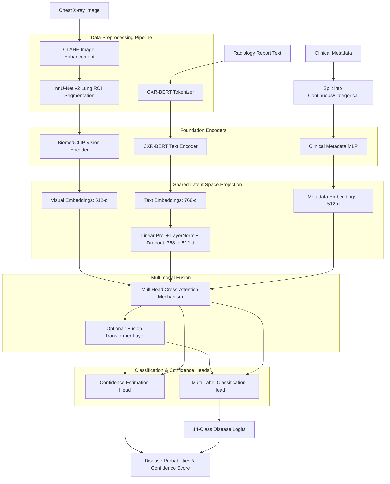

# Architecture Diagram and Workflow

> Historical v1 document. The corrected implementation and current gaps are documented in [audit/ARCHITECTURE.md](../audit/ARCHITECTURE.md). Do not use this older description as evidence of trained v2 behavior.

## Architecture Diagram

## End-to-End Workflow & Step-by-Step Outputs

### 1. Data Ingestion & Loading
**Process:** The `MultimodalCXRDataset` class receives raw image files, CSV metadata, and text reports. It uses modality configuration flags to dynamically enable or disable missing modalities.
**Output:** A structured batch containing raw images, raw text strings, and tabular metadata values.

### 2. Preprocessing & Augmentation
**Process:**
- Images are passed through CLAHE for contrast enhancement.
- `NNUNetWrapper` runs the image through nnU-Net v2 to extract Lung Regions of Interest (ROI) (bounding box and mask extraction).
- Text reports are passed into the `CXRBERTEncoder` tokenizer to convert raw strings into `input_ids` and `attention_mask`.
**Output:** Enhanced and cropped lung images, tokenized text tensors, and split metadata tensors.

### 3. Foundation Encoders (Feature Extraction)
**Process:** 
- **Vision:** `BiomedCLIPEncoder` processes the ROI cropped image using a Vision Transformer (ViT). (Outputs a `[Batch, 512]` tensor).
- **Text:** `CXRBERTEncoder` processes the tokenized reports. (Outputs a `[Batch, 768]` tensor).
- **Metadata:** `ClinicalMetadataEncoder` processes clinical fields via an MLP. (Outputs a `[Batch, 512]` tensor).
**Output:** Raw unimodal feature embeddings. 

### 4. Shared Latent Space Projection
**Process:** Because cross-attention requires inputs of the same dimensionality to perform mathematically sound dot products, the 768-dimensional Text embeddings are projected down to 512 dimensions.
- The `text_projection` block applies a Linear Layer `(768 -> 512)`, followed by `LayerNorm` and `Dropout`.
**Output:** All three modalities are now represented as `[Batch, 512]` tensors inside a shared geometric vector space.

### 5. Multimodal Fusion
**Process:** The aligned embeddings are fed into the `MultimodalCrossAttention` module. This module calculates semantic alignment between vision, text, and metadata using attention mechanisms. Optionally, this fused representation can be passed through a `FusionTransformer` for deeper contextual integration.
**Output:** A single, highly contextualized fused feature representation tensor.

### 6. Output Heads (Classification & Confidence)
**Process:**
- The fused representation is passed to the `MultiLabelClassificationHead` (an MLP that outputs raw logits for the 14 thoracic diseases).
- Simultaneously, it is passed to the `ConfidenceEstimationHead`, which applies temperature scaling to estimate how confident the model is in its predictions.
**Output:**
- **Logits:** The raw unnormalized predictions for each of the 14 classes.
- **Probabilities:** Sigmoid-activated probabilities for each disease (0 to 1).
- **Confidence Score:** A calculated confidence metric for the model's overall prediction certainty.
